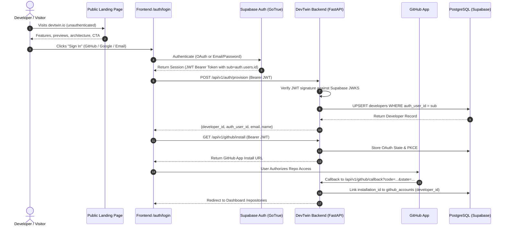
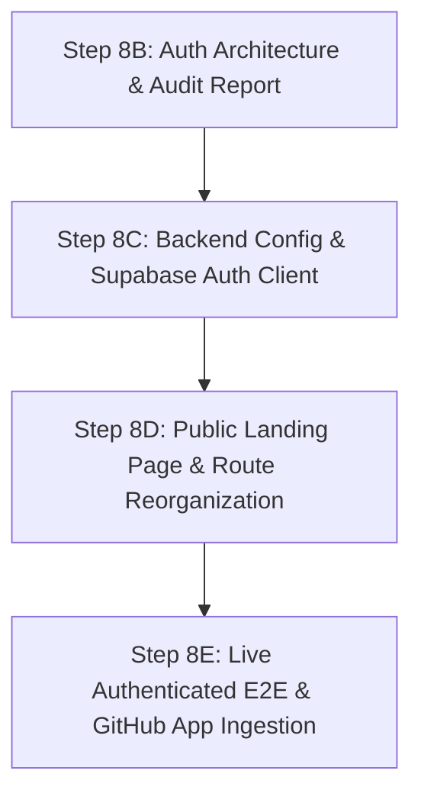

# DevTwin — Step 8B: Authentication Architecture & Configuration Audit Report

**Date:** 2026-10-21  
**Author:** Antigravity Agent  
**Status:** Complete Audit & Architecture Plan  
**Target File:** `step8b_auth_architecture_audit_report.md`  

---

## 1. Executive Verdict

**Verdict:** **AUDIT COMPLETE — READY FOR STEP 8C IMPLEMENTATION**

1. **Supabase Auth JWKS 404 Confirmed & Resolved**:
   - The reported HTTP 404 from Step 8A was caused by a configuration path error in `backend/.env`, where `SUPABASE_URL` was set to the PostgREST API path (`https://<project-ref>.supabase.co/rest/v1/`) instead of the project root URL (`https://<project-ref>.supabase.co`).
   - The security layer appended `/auth/v1/.well-known/jwks.json`, hitting PostgREST which returned `404 PGRST125: Invalid path specified in the request URL`.
   - Direct HTTP probing of the normalized root JWKS endpoint (`https://<project-ref>.supabase.co/auth/v1/.well-known/jwks.json`) returned **HTTP 200 OK** with an active Supabase Auth `ES256` public key (`kid: 3bb62e20-6e3e-43e7-a48e-61e1afb3a82d`).
   - Live JWT signature verification is fully viable once `SUPABASE_URL` is normalized.

2. **GitHub App Startup Blocker Identified**:
   - `backend/app/core/config.py` enforces mandatory Pydantic validation on 7 GitHub App variables (`GITHUB_APP_ID`, `GITHUB_APP_SLUG`, `GITHUB_CLIENT_ID`, `GITHUB_CLIENT_SECRET`, `GITHUB_PRIVATE_KEY`, `GITHUB_REDIRECT_URL`, `GITHUB_STATE_ENCRYPTION_KEY`) without defaults.
   - Missing GitHub App keys cause FastAPI startup failure, preventing unrelated features (public landing page, health check, developer registration, Google/email authentication) from operating.
   - A non-breaking configuration refactoring will make these settings optional at startup, gracefully disabling GitHub-specific endpoints (`/github/install`, `/github/callback`) with `HTTP 503 Service Unavailable` while allowing all core and authentication routes to run.

3. **Identity vs. Repository Authorization Decoupled**:
   - Supabase Auth will act strictly as the identity provider (handling GitHub OAuth login, Google OAuth login, and Email/Password credentials) issuing JWTs with `sub = auth.users.id`.
   - DevTwin provisions a `developers` row (`developers.auth_user_id = sub`).
   - GitHub repository access is an independent capability authorization handled via the DevTwin GitHub App (`/github/install` → `/github/callback` → `github_accounts` table). Users authenticated via Google or email can seamlessly connect a GitHub account post-authentication.

4. **Frontend Architecture Ready for Landing Page**:
   - The existing Next.js App Router structure currently mounts the dashboard overview at `/`.
   - The public landing page will be mounted at `/`, and the dashboard overview will be moved to `/overview`. Authenticated users navigating to `/` can optionally be redirected to `/overview`.
   - Dedicated authentication routes (`/auth/login`, `/auth/signup`, `/auth/callback`) will host the Supabase Auth UI and OAuth redirect handlers.

---

## 2. Audit of Existing Authentication & Authorization Implementation

### 2.1 Backend Implementation

| File Path | Component / Route | Current Behavior & Implementation Facts |
| :--- | :--- | :--- |
| `backend/app/core/config.py` | `Settings` class | Loads env via `pydantic-settings`. Enforces strict presence of `DATABASE_URL`, `SUPABASE_URL`, `SUPABASE_JWT_SECRET`, `SUPABASE_JWT_AUDIENCE`, and all 7 `GITHUB_*` variables. |
| `backend/app/core/security.py` | `get_current_developer_id` | Dependency extracting `Authorization: Bearer <token>`. In production, fetches JWKS from `{SUPABASE_URL}/auth/v1/.well-known/jwks.json`, caches keys for 1 hour (`jwks_cache_ttl`), and verifies RS256/ES256 signatures using `python-jose`. Extracts `sub` claim. In dev mode (`DEV_AUTH_BYPASS=True`), accepts `dev-token-<uuid>` if UUID matches a `developers.id`. |
| `backend/app/api/v1/auth.py` | `POST /api/v1/auth/provision` | Validates JWT, extracts `auth_user_id = sub`, queries `developers WHERE auth_user_id = :auth_user_id`. If exists, returns developer. If not, auto-creates developer record. |
| `backend/app/api/v1/developers.py` | `GET /api/v1/developers/me`<br>`PUT /api/v1/developers/me` | Fetches or updates developer profile for authenticated developer (`developer_id` resolved from `auth_user_id`). |
| `backend/app/api/v1/github.py` | `GET /api/v1/github/install`<br>`GET /api/v1/github/callback` | Implements OAuth state generation, PKCE S256 challenge, state claiming, and GitHub identity exchange. Links GitHub profile to `developers` record via `github_accounts` table. |
| `backend/app/workers/runner.py` | Pipeline Runner | Background analysis worker. Uses PostgreSQL-native locking (`SELECT ... FOR UPDATE SKIP LOCKED` on `analysis_jobs`). **Redis is not used** in the current analysis queue. |

### 2.2 Frontend Implementation

| File Path | Component / Route | Current Behavior & Implementation Facts |
| :--- | :--- | :--- |
| `frontend/src/lib/auth-context.tsx` | `AuthProvider`, `useAuth` | React Context managing developer identity. Currently uses dev bypass (`devtwin_dev_token` in `sessionStorage`). Contains ready state fields (`developer`, `token`, `isAuthenticated`, `isLoading`, `login`, `logout`). Structured as drop-in slot for `@supabase/supabase-js`. |
| `frontend/src/lib/api-client.ts` | `apiClient` | Wrapper around `fetch`. Automatically attaches `Authorization: Bearer <token>` when a token is stored in `sessionStorage`. Handles HTTP 401 and JSON serialization. |
| `frontend/src/app/page.tsx` | Dashboard Overview | Currently the root page displays the authenticated Developer Capability Dashboard directly. Lacks a public landing page. |
| `frontend/src/app/layout.tsx` | Root Layout | Wraps tree in `AuthProvider` and `AppShell`. Sidebar navigation is always rendered regardless of authentication state. |

### 2.3 Database Schema & RLS Policies

- **Table `developers`**:
  - `id UUID PRIMARY KEY DEFAULT gen_random_uuid()`
  - `auth_user_id UUID UNIQUE NOT NULL` (references Supabase `auth.users.id`)
  - `email VARCHAR(255) NOT NULL`, `name VARCHAR(255)`
- **Table `github_accounts`**:
  - `id UUID PRIMARY KEY DEFAULT gen_random_uuid()`
  - `developer_id UUID NOT NULL REFERENCES developers(id) ON DELETE CASCADE`
  - `github_id BIGINT UNIQUE NOT NULL`
  - `username VARCHAR(255) NOT NULL`
  - `installation_id BIGINT` (nullable, for GitHub App installations)
  - `disconnected_at TIMESTAMPTZ`
- **RLS Policies (`database/migrations/001_initial_schema.sql`)**:
  - All 27 tables have `ENABLE ROW LEVEL SECURITY`.
  - Service role / direct connection bypasses RLS in backend engine queries (`asyncpg` / `DATABASE_URL` pooler connects as `postgres` superuser/service-role).
  - Row ownership is enforced at the application/API layer via `get_current_developer_id` checking `developer_id`.

---

## 3. Root Cause Analysis: Supabase JWKS 404

### 3.1 Observation
Step 8A recorded:
`Supabase Auth JWKS: FAILED — HTTP 404 PGRST125: {"code":"PGRST125","details":null,"hint":null,"message":"Invalid path specified in the request URL"}`.

### 3.2 Root Cause
1. In `backend/.env`, the configured `SUPABASE_URL` was:
   `https://<project-ref>.supabase.co/rest/v1/`
2. `backend/app/core/security.py` constructs the JWKS URL as follows:
   ```python
   jwks_url = f"{settings.SUPABASE_URL.rstrip('/')}/auth/v1/.well-known/jwks.json"
   ```
3. This produced:
   `https://<project-ref>.supabase.co/rest/v1/auth/v1/.well-known/jwks.json`
4. The prefix `/rest/v1` routes to the **PostgREST** container in Supabase, not GoTrue (Supabase Auth). PostgREST evaluated `/auth/v1/.well-known/jwks.json` as a database table/view, found no matching schema object, and returned error code `PGRST125`.

### 3.3 Verification
A live HTTP probe against the canonical Supabase Auth endpoint:
`GET https://<project-ref>.supabase.co/auth/v1/.well-known/jwks.json`
returned:
- **HTTP Status:** `200 OK`
- **Content-Type:** `application/json`
- **Key Details:**
  - `alg: ES256`
  - `use: sig`
  - `kty: EC`
  - `crv: P-256`
  - `kid: 3bb62e20-6e3e-43e7-a48e-61e1afb3a82d`

### 3.4 Solution
1. In `backend/.env`, update `SUPABASE_URL` to the root project URL: `https://<project-ref>.supabase.co`.
2. In `backend/app/core/config.py`, add a Pydantic field validator to automatically strip `/rest/v1` or trailing slashes if accidentally provided:
   ```python
   @field_validator("SUPABASE_URL", mode="before")
   def normalize_supabase_url(cls, v: str) -> str:
       if isinstance(v, str):
           v = v.strip().rstrip("/")
           if v.endswith("/rest/v1"):
               v = v[:-8].rstrip("/")
       return v
   ```

---

## 4. GitHub App Startup Blocker & Graceful Startup Strategy

### 4.1 Observation
`backend/app/core/config.py` defines:
```python
GITHUB_APP_ID: int
GITHUB_APP_SLUG: str
GITHUB_CLIENT_ID: str
GITHUB_CLIENT_SECRET: str
GITHUB_PRIVATE_KEY: str
GITHUB_REDIRECT_URL: str
GITHUB_STATE_ENCRYPTION_KEY: str
```
Because no default values or `Optional` types are specified, Pydantic raises `pydantic.ValidationError` when `app.main` is imported without these variables in `.env`.

### 4.2 Impact
This hard failure completely blocks:
- The FastAPI server from starting.
- Health check probes (`GET /health`).
- OpenAPI docs generation (`/docs`).
- User authentication and developer provisioning via Supabase.
- Intelligence read queries and public landing page previews.

### 4.3 Recommended Strategy: Conditional GitHub App Readiness
1. **Refactor `Settings` in `backend/app/core/config.py`**:
   Make GitHub App settings optional with `None` as default:
   ```python
   GITHUB_APP_ID: int | None = None
   GITHUB_APP_SLUG: str | None = None
   GITHUB_CLIENT_ID: str | None = None
   GITHUB_CLIENT_SECRET: str | None = None
   GITHUB_PRIVATE_KEY: str | None = None
   GITHUB_REDIRECT_URL: str | None = None
   GITHUB_STATE_ENCRYPTION_KEY: str | None = None

   @property
   def is_github_app_configured(self) -> bool:
       return all([
           self.GITHUB_APP_ID,
           self.GITHUB_APP_SLUG,
           self.GITHUB_CLIENT_ID,
           self.GITHUB_CLIENT_SECRET,
           self.GITHUB_PRIVATE_KEY,
           self.GITHUB_REDIRECT_URL,
           self.GITHUB_STATE_ENCRYPTION_KEY,
       ])
   ```
2. **Graceful Endpoint Guards**:
   In `backend/app/api/v1/github.py`, add a dependency check:
   ```python
   def require_github_app():
       if not settings.is_github_app_configured:
           raise HTTPException(
               status_code=status.HTTP_503_SERVICE_UNAVAILABLE,
               detail="GitHub App integration is not configured on this DevTwin instance."
           )
   ```
   Apply `require_github_app` to `/github/install` and `/github/callback`.
3. **Security Principle**:
   This does **NOT** weaken security. No unauthenticated user can access repositories. It simply allows the API server to boot and serve landing, health, auth, and profile routes when GitHub repository mining is not yet configured.

---

## 5. End-to-End Authentication Architecture



### 5.1 Identity vs. Repository Authorization Decoupling
1. **Identity Provider (Supabase Auth)**:
   - Verifies the user's human identity via GitHub OAuth, Google OAuth, or Email/Password.
   - Issues a JWT where `sub` is the Supabase UUID (`auth.users.id`).
   - DevTwin API maps `sub` to `developers.auth_user_id`.
2. **Repository Provider (DevTwin GitHub App)**:
   - Grants DevTwin read access to private/public repositories and code contents.
   - Handled strictly via the GitHub App installation flow (`installation_id`).
   - Recorded in `github_accounts` linked to the developer's UUID.
   - **Key Benefit**: A developer who signs in with Google or Email can connect their GitHub account at any time without account collision or identity disruption.

### 5.2 Account Linking & Conflict Resolution
- **Rule 1 (No Unverified Auto-Merge)**: If a user signs in with Google (`alice@gmail.com`) and later signs in with GitHub (`alice@gmail.com`), DevTwin does NOT automatically merge the two `developers` records based solely on email string matching.
- **Rule 2 (Supabase Native Identity Linking)**: Account linking at the identity layer must be handled via Supabase's `linkIdentity()` API if supported, or treated as separate accounts.
- **Rule 3 (Repository Linking Conflict)**: When a developer links a GitHub account via `/github/callback`:
  - If `github_id` is already linked to the *same* `developer_id`: Update credentials and clear `disconnected_at`.
  - If `github_id` is linked to a *different* `developer_id`: Return `HTTP 409 Conflict` ("This GitHub account is already connected to another DevTwin developer profile.").
  - If `github_id` is new: Create a new `github_accounts` record.

### 5.3 Session & API Security Rules
1. **Bearer Token Propagation**: Frontend transmits Supabase access token in `Authorization: Bearer <token>` on all `/api/v1/*` requests.
2. **Zero Client Secrets**: The Supabase `service_role` key and GitHub App private key are strictly server-side environment variables. Only the public Supabase Anon key (`NEXT_PUBLIC_SUPABASE_ANON_KEY`) is bundled into the frontend.
3. **JWT Verification**: Backend verifies JWT on every request:
   - Validates signature against cached Supabase JWKS.
   - Validates `exp` (expiry) and `aud` (audience = `authenticated`).
   - Resolves `developer_id` from the database.

---

## 6. Public Landing Page & Route Reorganization Plan

### 6.1 Route Structure

| Route | Access | Purpose |
| :--- | :--- | :--- |
| `/` | **Public** | High-impact DevTwin product landing page. No authentication required. |
| `/auth/login` | **Public** | Sign-in page with GitHub, Google, and Email/password options. |
| `/auth/signup` | **Public** | Sign-up page with email verification info and OAuth triggers. |
| `/auth/callback` | **Public** | OAuth redirect target handling Supabase session exchange. |
| `/overview` | **Protected** | Capability dashboard overview (previously at `/`). |
| `/skills` | **Protected** | Interactive SkillGraph visualization & filtering. |
| `/capabilities` | **Protected** | Capability scoring breakdown and temporal trends. |
| `/coderisk` | **Protected** | CodeRisk pattern analysis and hotspots. |
| `/evidence` | **Protected** | Raw observation provenance and commit audit log. |
| `/jobs` | **Protected** | Repository analysis jobs, status, and execution logs. |
| `/settings` | **Protected** | GitHub connection status, developer profile, disconnect options. |

### 6.2 Public Landing Page Design Specifications
- **Theme**: Dark-first, technical, minimalist SaaS aesthetic consistent with DevTwin's `#0B0F17` / `#111827` surface palette and `#10B981` (emerald) / `#06B6D4` (cyan) accents.
- **Key Sections**:
  1. **Header / Navbar**: DevTwin branding, links to *Capabilities*, *How it Works*, *Architecture*, *Docs*, and a prominent *Sign In* / *Get Started* CTA button.
  2. **Hero Section**:
     - Headline: "Developer Capability Intelligence — Proven by Code, Not Resumes."
     - Subheadline: "Autonomous repository mining, deterministic AST pattern analysis, and verifiable capability graphs."
     - CTAs: "Analyze Repositories" and "Explore Interactive Demo".
     - Terminal / Graph preview card showcasing real AST observations transforming into SkillGraph nodes.
  3. **Core Capability Pillars**:
     - **SkillGraph**: Deterministic concept and technology mapping.
     - **CodeRisk Engine**: Anti-pattern, testing deficit, and complexity analysis.
     - **Evidence Provenance**: Unforged lineage from Git commit to capability score.
     - **Explainable Scores**: Multi-dimensional confidence modeling without black-box LLM scoring.
  4. **How It Works (Workflow)**:
     - 4-step sequence: Connect GitHub → Autonomous Mining → Graph Synthesis → Continuous Capability Tracking.
  5. **Interactive Dashboard Previews**:
     - Embedded previews of SkillGraph canvas and capability breakdown cards.
  6. **Call To Action & Footer**:
     - Final sign-up banner, GitHub repo link, architectural documentation links, and copyright.

### 6.3 Route Protection & Redirect Strategy
- Create `frontend/src/components/auth/protected-route.tsx` or Next.js middleware.
- When an unauthenticated visitor accesses `/overview`, `/skills`, etc.:
  - Record the target path in `returnTo` search param.
  - Redirect to `/auth/login?returnTo=/overview`.
- When an authenticated user visits `/auth/login` or `/auth/signup`:
  - Redirect directly to `/overview`.
- The public landing page (`/`) will show "Open Dashboard" CTA instead of "Sign In" when authenticated.

---

## 7. Configuration Inventory & Provider Console Setup

### 7.1 Environment Variable Inventory

| Variable Name | Required Scope | Target File | Purpose | Client-Safe? |
| :--- | :--- | :--- | :--- | :--- |
| `DATABASE_URL` | Core Backend | `backend/.env` | PostgreSQL pooler connection string | **NO (Secret)** |
| `SUPABASE_URL` | Core Backend | `backend/.env` | Canonical Supabase project root URL | Public URL |
| `SUPABASE_JWT_SECRET` | Core Backend | `backend/.env` | Supabase JWT secret for HS256 fallback | **NO (Secret)** |
| `SUPABASE_JWT_AUDIENCE` | Core Backend | `backend/.env` | JWT audience (`authenticated`) | Non-secret |
| `DEV_AUTH_BYPASS` | Development | `backend/.env` | Enables `dev-token-<uuid>` header in tests | Non-secret |
| `GITHUB_APP_ID` | GitHub Integration | `backend/.env` | Numeric App ID from GitHub App settings | Non-secret |
| `GITHUB_APP_SLUG` | GitHub Integration | `backend/.env` | GitHub App URL slug | Non-secret |
| `GITHUB_CLIENT_ID` | GitHub Integration | `backend/.env` | GitHub OAuth client ID | Public ID |
| `GITHUB_CLIENT_SECRET` | GitHub Integration | `backend/.env` | GitHub OAuth client secret | **NO (Secret)** |
| `GITHUB_PRIVATE_KEY` | GitHub Integration | `backend/.env` | PEM private key for installation tokens | **NO (Secret)** |
| `GITHUB_REDIRECT_URL` | GitHub Integration | `backend/.env` | OAuth callback URL (`/api/v1/github/callback`) | Non-secret |
| `GITHUB_STATE_ENCRYPTION_KEY` | GitHub Integration | `backend/.env` | 32-byte AES key for PKCE state cookies | **NO (Secret)** |
| `NEXT_PUBLIC_SUPABASE_URL` | Frontend | `frontend/.env.local` | Canonical Supabase project root URL | Public URL |
| `NEXT_PUBLIC_SUPABASE_ANON_KEY` | Frontend | `frontend/.env.local` | Supabase anonymous public API key | Public Key |
| `NEXT_PUBLIC_API_URL` | Frontend | `frontend/.env.local` | DevTwin backend API URL | Public URL |

### 7.2 Third-Party Console Setup Instructions

#### A. Supabase Project Console
1. Navigate to **Authentication → URL Configuration**:
   - Set **Site URL** to `http://localhost:3000` (or production domain).
   - Add **Redirect URLs**:
     - `http://localhost:3000/auth/callback`
     - `http://localhost:3000/overview`
2. Navigate to **Authentication → Providers**:
   - **Email**: Enable Email provider. Disable email confirmations for local development if desired.
   - **GitHub**:
     - Enable GitHub provider.
     - Fill in GitHub OAuth App Client ID & Client Secret (from GitHub Developer Settings).
   - **Google**:
     - Enable Google provider.
     - Fill in Google Cloud OAuth 2.0 Client ID & Client Secret.
     - Add authorized redirect URI to Google Cloud Console: `https://<project-ref>.supabase.co/auth/v1/callback`.

#### B. GitHub App Console (for Repository Analysis)
1. Go to **GitHub Settings → Developer Settings → GitHub Apps → New GitHub App**.
2. **App Name**: `devtwin-intelligence` (or custom name).
3. **Homepage URL**: `https://devtwin.io` (or `http://localhost:3000`).
4. **Callback URL**: `http://localhost:8000/api/v1/github/callback`.
5. **Permissions**:
   - Repository Permissions:
     - `Contents: Read-only` (to read code and AST)
     - `Metadata: Read-only` (default)
     - `Pull requests: Read-only`
6. **Generate Private Key**: Download `.pem` key file and set as `GITHUB_PRIVATE_KEY`.
7. **Install App**: Install the app on your personal GitHub account or organization.

---

## 8. Verified Facts vs. Assumptions

### Verified Facts
1. Database connectivity to Supabase AWS PostgreSQL pooler is operational; all 27 tables are created with RLS enabled.
2. The Supabase JWKS endpoint at `https://<project-ref>.supabase.co/auth/v1/.well-known/jwks.json` returns HTTP 200 with an active `ES256` public key.
3. The previous HTTP 404 was due to `/rest/v1/` being incorrectly appended to `SUPABASE_URL` in `backend/.env`.
4. Background job scheduling in `workers/runner.py` is entirely PostgreSQL-native via `SELECT ... FOR UPDATE SKIP LOCKED`; Redis is not in the execution path.
5. All 367 backend unit/integration tests pass in the Python 3.12 virtual environment.
6. The frontend currently compiles with zero lint errors, 36 passing Vitest tests, and 21 passing Playwright tests.

### Assumptions & Constraints
1. Real GitHub App secrets have not yet been placed in `backend/.env`. Therefore, the backend must support graceful startup without GitHub App keys.
2. Supabase client libraries (`@supabase/supabase-js`, `@supabase/ssr`) are not yet installed in `frontend/package.json`.
3. Live Supabase RLS multi-tenant separation has not yet been verified with real user tokens because no developers exist in the live database.

---

## 9. Implementation Roadmap & Next Milestones



- **Step 8C (Backend Normalization & Frontend Supabase Integration)**:
  - Add `normalize_supabase_url` validator in `backend/app/core/config.py`.
  - Make GitHub App keys optional in `Settings` so backend boots gracefully when unconfigured.
  - Install `@supabase/supabase-js` in `frontend/`.
  - Wire real Supabase session events into `frontend/src/lib/auth-context.tsx`.
- **Step 8D (Public Landing Page & Auth Flow)**:
  - Create the public landing page at `/`.
  - Relocate the current authenticated overview to `/overview`.
  - Implement `/auth/login`, `/auth/signup`, and `/auth/callback` routes.
  - Add client-side route protection.
- **Step 8E (Live E2E Verification & Pipeline Ingestion)**:
  - Execute end-to-end signup/login flow with live Supabase Auth.
  - Complete GitHub App installation and repository analysis execution.

---
*End of Report.*
